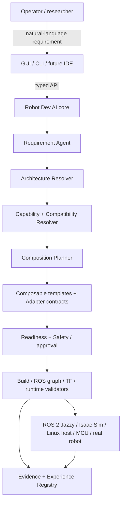
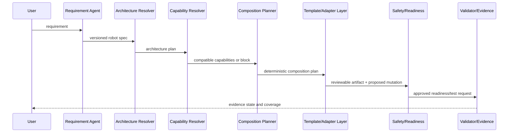

# v0.4 composable integration architecture

**Version:** 0.1 (2026-10-12)

**Status:** active design baseline for G12.5

**Direction:** `docs/roadmap_v0.4.md`

## 1. Scope, actors, and concerns

Robot Dev AI turns a natural-language robot requirement into an explainable,
deployable ROS 2 integration plan. G12.5 owns the core decisions between the
requirement and generated artifacts: compute architecture, capabilities,
component composition, adapter selection, readiness evidence, and mutation
safety. It preserves the current Jazzy/Isaac/Ubuntu stack.

In scope: differential-drive reference robots, Linux Host/Jetson/MCU topology
reasoning, known and unknown component handling, component templates, adapter
contracts, and validation/safety evidence. Out of scope: arbitrary MCU firmware
flashing, protocol reverse engineering, direct browser ROS/motor control,
universal morphology support, and Cosmos physics.

| Stakeholder | Concern | Realization |
|---|---|---|
| Operator / researcher | Reproducible explainable integration choice | Architecture/composition plans with provenance and evidence status |
| Hardware integrator | Safe handling of incomplete or non-ROS hardware | Unknown-component flow, readiness gate, human approval |
| ROS developer | Stable artifacts and contracts | Component templates and versioned adapter interfaces |
| Thesis evaluator | Generalization beyond one hard-coded robot | Heterogeneous G12.5 cases, later M16 benchmark/ablation |
| M14 viewer | Readable state without control authority | Typed API only; current GUI stays a consumer after core freeze |

## 2. Context and topology

The arrow sequence is synchronous in-process typed Python calls in the current
single-host deployment. ROS processes and hardware are external dependencies;
their discovery/results enter only through allowlisted collectors and structured
evidence. The GUI never receives ROS credentials or shell authority.

## 3. Major components

| Component | Responsibility | Input / output boundary |
|---|---|---|
| Requirement Agent | Convert user intent into a versioned robot spec with ambiguity/provenance | Typed request → robot specification |
| Architecture Resolver | Choose or block compute/control topology | Robot spec + resource/capability facts → architecture plan |
| Capability Resolver | Check constraints and compatibility of selected elements | Plans + registry facts → supported/degraded/blocked result |
| Composition Planner | Select a deterministic component graph independent of file generation | Architecture/capabilities → composition plan |
| Registry | Own versioned component facts, limitations, verification state, and provenance | Read models + migration boundary |
| Template/Adapter layer | Render stable component artifacts and adapter contracts | Composition plan → reviewable generated artifacts |
| Readiness/Safety layer | Evidence whether a target is ready and gate mutations | Readiness facts + human approval → permit/block decision |
| Validators/Evidence | Collect and classify build, graph, runtime, simulation, and later real evidence | Commands/observations → versioned evidence records |
| Presentation API | Expose typed state without ROS shell/control logic | HTTP contract → GUI/CLI |

## 4. Boundary and failure stance

| Boundary | Contract owner | Slow/down/unknown behavior |
|---|---|---|
| Requirement → architecture | Core schema | Return ambiguity or `BLOCKED`; never invent a runnable topology |
| Registry → resolvers | Versioned registry models | Missing fact becomes `UNKNOWN`/`BLOCKED`, retaining provenance |
| Composition → generation | Composition-plan schema | No file write until plan is deterministic and confirmed |
| Adapter → ROS/hardware | Adapter contract + readiness evidence | Sandbox/diagnostic first; no actuator enable after a failed readiness check |
| Validator → execution | Allowlisted collectors / scenario validators | Timeout/failure is evidence, never interpreted as absence or PASS |
| API → presentation | Typed API | Read-only LAN mode rejects non-read requests; API never becomes a hardware-control path |

## 5. Key runtime flow

If any stage lacks evidence, it returns a structured non-success state instead
of continuing: `BLOCKED`, `NOT_TESTED`, `UNSUPPORTED`, or `DEGRADED` are not
aliases for failure or success.

## 6. Quality, safety, and operations

| Quality concern | Mechanism |
|---|---|
| Reproducibility | Versioned schema, migration, provenance, commit/environment/log references in evidence |
| Safety | Diff + explicit approval + apply/rebuild/retest/rollback transaction for mutations; no browser actuator path |
| Generalization | Architecture and composition plans represent components rather than relying on one full-robot template |
| Resilience | Boundary failures become evidence; collectors time out explicitly; hardware readiness blocks escalation |
| Resource fit | Resource profile produces runnable/degraded/unsupported/remote-required decision before generation |
| Observability | Evidence records include command/test ID, time, environment, expected/observed result, confidence, and coverage |
| Secrets/privacy | No token, SSH key, or credential enters prompt/template/log; deployment secrets remain environment-owned |

The main trade-off is slower first-time onboarding versus unsafe automatic
generation. v0.4 chooses explicit provisional/blocked states, because a
plausible but unverified hardware integration is not safe evidence.

## 7. Decision index

| ADR | Decision | Status |
|---|---|---|
| [0008](decisions/0008-composable-architecture-before-real-hardware.md) | Complete G12.5 composable core refactor before M15 real-hardware execution | Accepted |

Existing stack decisions remain in `docs/DECISIONS.md`; this architecture does
not change ROS 2 Jazzy, system Python, Isaac Sim 4.5 Docker, or the GUI typed
API boundary.

## 8. Assumptions and open questions

- Exact MCU/base/LiDAR/transport details remain unknown; the schema must model
  them as unknown, provisional, experimental, or verified rather than assume
  ESP32/micro-ROS.
- Jetson hardware has not been evidenced in this repository; resource profiles
  are a design contract until actual inventory is recorded.
- Initial adapter implementations require their own technical designs and
  contract tests. micro-ROS and `ros2_control` are candidate boundaries, not
  universal default drivers. Official [micro-ROS architecture material](https://micro.ros.org/download/2021-04-13-ERF-bosch.pdf) and [ROS 2 Jazzy hardware-interface documentation](https://docs.ros.org/en/ros2_packages/jazzy/api/joint_state_topic_hardware_interface/__PACKAGE.html) are reference inputs, not validation evidence for a specific device.

## Changelog

| Version | Date | Change |
|---|---|---|
| 0.1 | 2026-10-12 | Initial v0.4/G12.5 architecture baseline derived from the user-supplied roadmap. |
